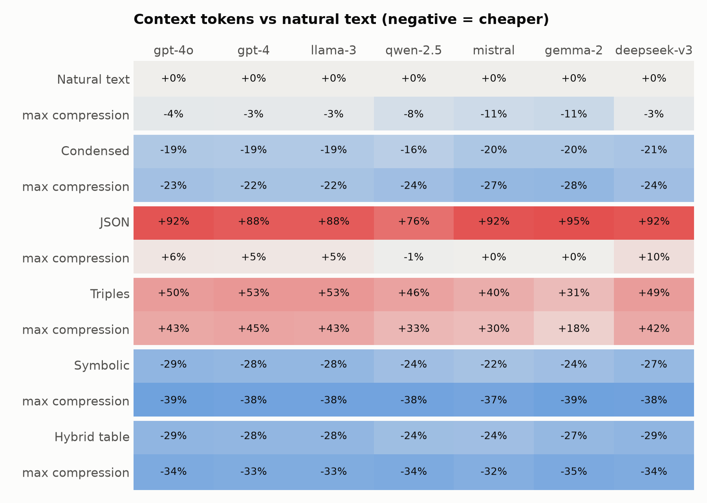

# TOKENMIND

> What if LLMs didn't need human language to communicate?

TOKENMIND is an experimental engine that looks for the most token-efficient
way to give information to a large language model without degrading its
answers. It renders the same facts as natural text, condensed text, JSON,
semantic triples, a custom symbolic notation and hybrids, counts their tokens
with several tokenizers, asks several models to answer questions about them,
and selects the cheapest representation that keeps answers correct.

## Hypotheses

- **H1** — the optimal representation depends on the tokenizer and the model.
- **H2** — the optimal representation depends on the task.

The full protocol is in [docs/design.md](docs/design.md).

## Status

The first local run is published: **12,000 graded answers on two models
(Llama 3.2 3B and Qwen 2.5 3B), five tasks and 40 items per cell**.
Compressed symbolic contexts used about **36–39% fewer context tokens** than
natural text on this sample. This measures context tokens, not total billed
tokens or inference time.



The [preliminary report](docs/results.md) includes task/model comparisons,
accuracy against compression, and the negative results: aggregation and
filtering accuracy remain low even without compression. Token savings do
not establish a useful answer-quality trade-off on those tasks.

**The full benchmark is still pending**: the protocol requires at least
four model families and 100 items per cell. These two-model results do not
complete [#9](https://github.com/rmouahid/tokenmind/issues/9); a v1.0.0
release awaits the complete run and its analysis.

## Run the benchmark on your computer

The benchmark runs free, local models through [Ollama](https://ollama.com).
Nothing leaves your machine except the one-off download of tokenizer files
from Hugging Face.

1. Install Ollama, then pull the four default models (one per family):

   ```bash
   ollama pull llama3.2:3b
   ollama pull qwen2.5:3b
   ollama pull gemma2:2b
   ollama pull mistral:7b
   ```

2. Install Python 3.12 and Poetry, then the project:

   ```bash
   git clone https://github.com/rmouahid/tokenmind
   cd tokenmind
   poetry install
   ```

3. Try a short run first (5 worlds, levels 0 and 4: 1,200 answers):

   ```bash
   poetry run tokenmind benchmark --quick
   ```

   The trial writes to `runs/quick/` by default. Use `--out` to choose another directory.

4. Run the full benchmark (100 worlds, 6 representations, 5 levels:
   15,000 answers per model):

   ```bash
   poetry run tokenmind benchmark
   ```

   To run the full protocol and generate its report and charts in one command:

   ```bash
   poetry run tokenmind benchmark && poetry run tokenmind report
   ```

   It prints progress and the time left. Every answer is cached in `cache/`,
   so you can stop it with Ctrl+C and run the same command again to resume.
   Use `--worlds 40` for a shorter run, `--models` to choose other models.

Full benchmark results land in `results/` by default:

| File | Content |
| --- | --- |
| `items.jsonl` | the seeded questions and gold answers |
| `tokens.csv` | mean context tokens per representation, level and tokenizer |
| `answers.jsonl` | every answer, graded |
| `cells.csv` | accuracy with 95 % interval per model, task, representation, level |
| `best.csv` | cheapest representation per model and task within 98 % of natural-text accuracy |

Other OpenAI-compatible providers work too:
`TOKENMIND_API_KEY=... poetry run tokenmind benchmark --provider openrouter --models qwen/qwen-2.5-7b-instruct`.

## Development

```bash
poetry install
poetry run pytest -q
poetry run ruff check . && poetry run ruff format --check .
```

## License

MIT
