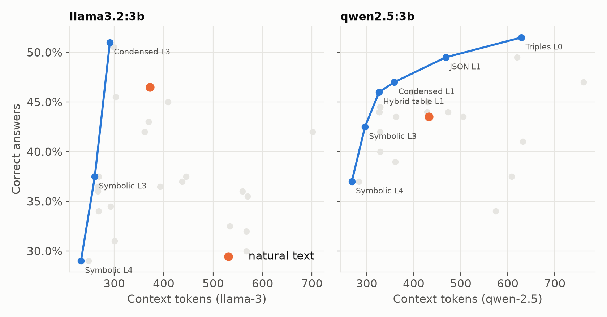
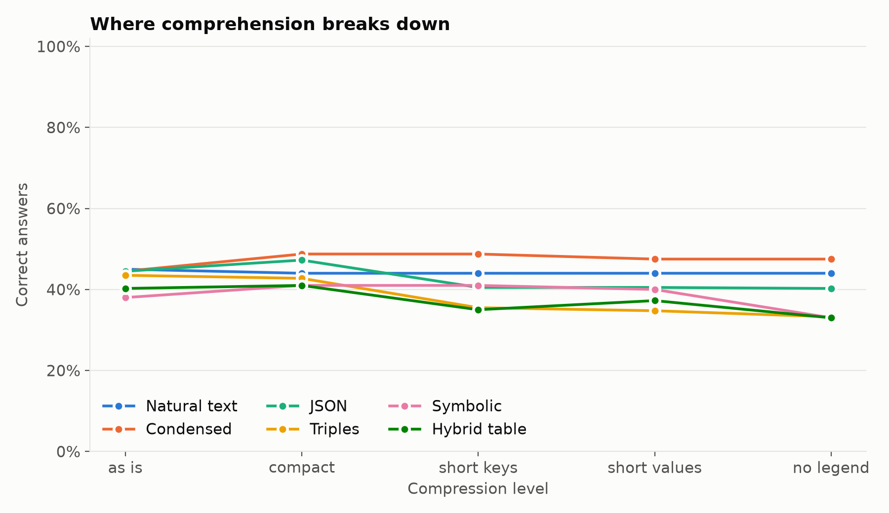

# Results (preliminary)

> **Partial run — not the full benchmark required by [#9](https://github.com/rmouahid/tokenmind/issues/9).**

Generated by `tokenmind report` from `results/` for an intermediate local run:

- **Models (2, 2 families):** `llama3.2:3b`, `qwen2.5:3b` (target for #9: ≥ 4 models from different families)
- **Scope:** 5 tasks, 40 worlds/items per cell (target for #9: ≥ 100 items per cell), 6 representations × 5 compression levels
- **Volume:** 200 items, 12,000 graded answers (`results/answers.jsonl`, `results/cells.csv`, `results/best.csv`, `results/tokens.csv`)

These results are published as a first checkpoint. A full benchmark run and a deeper, final discussion are still needed to close #9.

## H1 — token cost depends on the tokenizer

| Tokenizer | Cheapest representation | vs natural text |
| --- | --- | --- |
| gpt-4o | Symbolic L4 | -39% |
| gpt-4 | Symbolic L4 | -38% |
| llama-3 | Symbolic L4 | -38% |
| qwen-2.5 | Symbolic L4 | -38% |
| mistral | Symbolic L4 | -37% |
| gemma-2 | Symbolic L4 | -39% |
| deepseek-v3 | Symbolic L4 | -38% |

## Accuracy against tokens, per model

## Where comprehension breaks down

## H2 — the best representation per model and task

Cheapest representation within 98 % of natural-text accuracy (preliminary).

| Model | Task | Best | Accuracy | Natural text | Tokens |
| --- | --- | --- | --- | --- | --- |
| llama3.2:3b | aggregation | Symbolic L4 | 12% | 8% | -38% (llama-3) |
| llama3.2:3b | comparison | Condensed L3 | 57% | 50% | -22% (llama-3) |
| llama3.2:3b | filtering | Hybrid table L1 | 12% | 5% | -28% (llama-3) |
| llama3.2:3b | lookup | Symbolic L3 | 98% | 98% | -30% (llama-3) |
| llama3.2:3b | multihop | Condensed L3 | 78% | 72% | -22% (llama-3) |
| qwen2.5:3b | aggregation | Hybrid table L4 | 22% | 15% | -34% (qwen-2.5) |
| qwen2.5:3b | comparison | Condensed L3 | 60% | 45% | -24% (qwen-2.5) |
| qwen2.5:3b | filtering | Hybrid table L1 | 18% | 8% | -24% (qwen-2.5) |
| qwen2.5:3b | lookup | Symbolic L4 | 95% | 95% | -38% (qwen-2.5) |
| qwen2.5:3b | multihop | Symbolic L3 | 62% | 55% | -31% (qwen-2.5) |

## Preliminary discussion and limitations

- **Token savings (H1):** on this sample, maximally compressed symbolic notation is the cheapest across the tested tokenizers (~36–39% fewer context tokens vs natural text), consistent with the earlier token-only measurement.
- **Task/model sensitivity (H2, preliminary):** the best fidelity-preserving representation varies by task and model (e.g. lookup tolerates strong compression in symbolic form with near-baseline accuracy; comparison/multihop favor condensed or moderately compressed forms here). This supports H2 directionally but is based on only 2 models.
- **Negative/weak results:** absolute accuracy is **very low** on some tasks regardless of representation — notably **aggregation** (best ~12–22%) and **filtering** (best ~12–18%) in this run, sometimes only marginally above or even reflecting low baselines. Compression is not a win if the task is poorly solved; these cases need scrutiny in the full benchmark.
- **Comprehension vs compression:** the degradation curves show that accuracy does not decrease uniformly with compression; some compact forms match or exceed natural text on specific tasks/models, while others regress. Conclusions about “safe” compression levels remain tentative.
- **Limitations:** only 2 small models from 2 families, 40 items/cell (wide uncertainty), local Ollama run; results may not generalize to larger models/families or the full 100-item protocol. Full #9 scope (≥ 4 models, ≥ 100 items/cell) and a more detailed analysis (including negative results) are still required.
