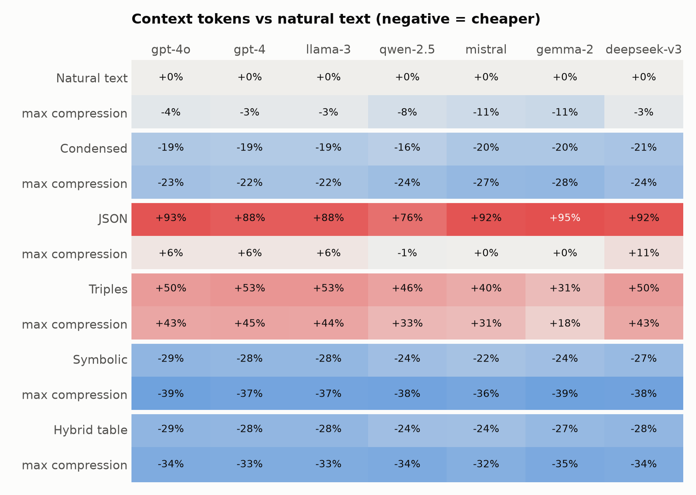

# Results

Generated by `tokenmind report` from `results/`.

## H1 — token cost depends on the tokenizer

| Tokenizer | Cheapest representation | vs natural text |
| --- | --- | --- |
| gpt-4o | Symbolic L4 | -39% |
| gpt-4 | Symbolic L4 | -37% |
| llama-3 | Symbolic L4 | -37% |
| qwen-2.5 | Symbolic L4 | -38% |
| mistral | Symbolic L4 | -36% |
| gemma-2 | Symbolic L4 | -39% |
| deepseek-v3 | Symbolic L4 | -38% |
